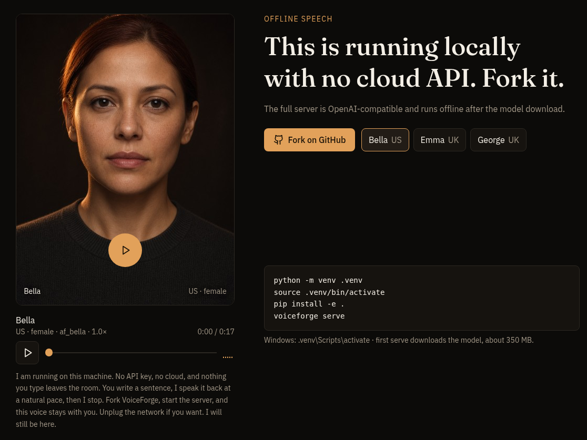

# VoiceForge

[](https://github.com/MiMindMendinc/VoiceForge/actions/workflows/voiceforge.yml)
[](LICENSE)

See [CHANGELOG.md](CHANGELOG.md) for what’s new in 1.2.0.

[](https://spruce-winter-royal-sunny.grok.me)

**[Hear the voices on the showcase page](https://spruce-winter-royal-sunny.grok.me)**: Bella, Emma, and George, rendered offline with the same Kokoro model VoiceForge serves.

**Give your local LLM a voice.** Generate speech on your own computer, or connect
an app through the [OpenAI-compatible speech API](docs/LLM.md).

On the working local page, with status **Ready** and voice **Bella (US, female)** at 1.00×,
VoiceForge spoke “Hello. This is VoiceForge speaking. I am running locally, with no cloud API.”
and generated the clip in **0.8 seconds**. That capture is from v1.1.0.

Already set up? Start with one command: `voiceforge serve`, then open
**http://localhost:8000**, type, and press **Speak** (or **Ctrl/⌘ + Enter**).
For first-time setup, follow [Quick start](#quick-start).

A local, free, high-quality text-to-speech server. Speech is generated on your
machine by the open-source [Kokoro](https://huggingface.co/hexgrad/Kokoro-82M)
model running through ONNX. There are no API keys, no accounts, and no network
calls at runtime. Any app that can make an HTTP request can use it.

## Requirements

- Python 3.10 or newer
- About 350 MB of disk space for the model files
- Windows, macOS, or Linux. Speech runs on the CPU, so no GPU is needed.

## Quick start

Run these commands from the repository root:

```bash
python -m venv .venv
source .venv/bin/activate          # Windows: .venv\Scripts\activate
pip install -e .
voiceforge serve
```

`voiceforge serve` downloads any missing model files (about 350 MB) before it
starts the server. Use `voiceforge serve --no-download` to skip that, or
`voiceforge download` to fetch or verify the files without starting the server.

Then open **http://localhost:8000** in your browser, type something, and press
**Speak** (or **Ctrl/⌘ + Enter**).

On Windows PowerShell, activate the environment with `.venv\Scripts\Activate.ps1`.

## Docker

A CPU `Dockerfile` is in the repository root. The image does not bake in the
model files. It installs FFmpeg (with `libmp3lame` and `libopus` for MP3/Opus)
and listens on `0.0.0.0:8000` inside the container.

```bash
docker build -t voiceforge .
docker run --rm -p 8000:8000 -v "$PWD/models:/app/models" voiceforge
```

The container starts with `voiceforge serve` and `VOICEFORGE_NO_DOWNLOAD=1`, so
it will not download models unless you set `VOICEFORGE_NO_DOWNLOAD=0`. Mount a
`models/` folder as shown so the speech files persist on the host.

## Hook it to your LLM

See [the LLM hook-up guide](docs/LLM.md) for `POST /v1/audio/speech`
and copy-paste Ollama, llama.cpp, and Open WebUI setups.

## Model files

`download_models.py` saves two files into `models/`:

| File | Size | Purpose |
| --- | --- | --- |
| `kokoro-v1.0.onnx` | ~310 MB | the speech model |
| `voices-v1.0.bin` | ~27 MB | voice embeddings |

Both files are checked against pinned SHA-256 checksums, after every download
and when they already exist. A file that does not match is replaced, and a
download that does not match is discarded, so a corrupted or tampered file is
never used. The upstream project does not publish checksums, so the pinned
values were computed from its official `model-files-v1.0` release files.

| Command | What it does |
| --- | --- |
| `voiceforge download` | downloads missing or unverified files |
| `voiceforge download --check` | verifies the files you have, downloads nothing |
| `voiceforge download --force` | downloads both files again |
| `python download_models.py` | same checks, if you prefer the script directly |

To download manually, get both files from the
[model-files-v1.0 release](https://github.com/thewh1teagle/kokoro-onnx/releases/tag/model-files-v1.0),
place them in `models/`, and run `python download_models.py --check`.

The server starts even if the files are missing. In that case the demo page
shows instructions, `/speak` returns HTTP 503 with the same instructions, and
`/health` reports what is missing.

## Configuration

Set these environment variables before starting the server, all optional:

| Variable | Default | Meaning |
| --- | --- | --- |
| `VOICEFORGE_HOST` | `127.0.0.1` | Address to listen on. Use `0.0.0.0` to listen on every network interface. |
| `VOICEFORGE_PORT` | `8000` | Port to listen on. |
| `VOICEFORGE_MODEL_DIR` | `./models` | Folder that contains the model files. |
| `VOICEFORGE_ALLOWED_HOSTS` | `localhost,127.0.0.1,::1` | Comma-separated host names accepted in requests. `*` accepts any. |
| `VOICEFORGE_ALLOWED_ORIGINS` | none | Comma-separated web origins, such as `http://localhost:3000`, that may call the API from a browser. |
| `VOICEFORGE_MAX_QUEUE` | `4` | Most speech requests allowed to run or wait at once. Extra requests get HTTP 503. |

Example, on macOS or Linux:

```bash
VOICEFORGE_PORT=8001 python server.py
```

### Security defaults

VoiceForge is built to run on your own computer. By default:

- It listens only on `127.0.0.1`, so other devices cannot connect.
- It accepts only the host names `localhost`, `127.0.0.1` and `::1`. This stops
  a malicious web page from reaching it through DNS rebinding.
- It rejects browser requests from other websites (`Origin` checks). Only the
  built-in demo page, and any origins you list in `VOICEFORGE_ALLOWED_ORIGINS`,
  can call it from a browser. Scripts and apps that are not browsers are unaffected.
- Request bodies are limited to 64 KB, and at most `VOICEFORGE_MAX_QUEUE`
  speech requests run or wait at once.

VoiceForge has no authentication. To use it from other devices, set
`VOICEFORGE_HOST=0.0.0.0` and add this computer's name or IP address to
`VOICEFORGE_ALLOWED_HOSTS`, and only do this on a network you trust:

```bash
VOICEFORGE_HOST=0.0.0.0 VOICEFORGE_ALLOWED_HOSTS=192.168.1.20,localhost python server.py
```

## HTTP API

Errors always return JSON in the form `{"error": "message"}`.

### `POST /speak`

Request body (JSON):

| Field | Type | Default | Notes |
| --- | --- | --- | --- |
| `text` | string | required | 1 to 5,000 characters, must include letters or numbers |
| `voice` | string | server default | a voice id from `GET /voices` |
| `speed` | number | `1.0` | from `0.5` (slow) to `2.0` (fast) |

Response: `200 OK` with `Content-Type: audio/wav` (16-bit PCM, 24 kHz, mono).

```bash
curl -X POST http://localhost:8000/speak \
  -H "Content-Type: application/json" \
  -d '{"text": "Hello from VoiceForge", "voice": "af_bella", "speed": 1.0}' \
  --output hello.wav
```

| Status | Meaning |
| --- | --- |
| `400` | Text is empty or longer than 5,000 characters, has no letters or numbers, or the voice is unknown. Also returned for a host name that is not allowed. |
| `403` | A browser request came from a website that is not allowed. See `VOICEFORGE_ALLOWED_ORIGINS`. |
| `413` | The request body is larger than 64 KB. |
| `422` | The body is not valid JSON, a field is out of range (such as a speed of 3), or the text produced no audio. |
| `503` | The model is not installed or failed to load (see `/health`), or the server is busy. A busy response includes a `Retry-After` header. |
| `500` | An unexpected error. Details are written to the server log, not sent to the client. |

### `POST /v1/audio/speech`

OpenAI-compatible endpoint. Apps that already talk to OpenAI's speech API can
point at VoiceForge instead. Speech is generated the same way as `POST /speak`.

Request body (JSON):

| Field | Type | Default | Notes |
| --- | --- | --- | --- |
| `input` | string | required | Same text rules as `/speak` |
| `model` | string | `voiceforge` | Accepted for compatibility; this server has one model |
| `voice` | string | `af_bella` | A Kokoro voice id, or one of the OpenAI names below |
| `speed` | number | `1.0` | from `0.5` to `2.0` |
| `response_format` | string | `wav` | `wav`, `mp3`, or `opus` |

OpenAI voice names map to these Kokoro English voices. Native ids such as
`af_bella` or `bf_emma` are accepted unchanged.

| OpenAI name | Kokoro voice |
| --- | --- |
| `alloy` | `af_heart` |
| `echo` | `am_adam` |
| `fable` | `bm_george` |
| `onyx` | `am_michael` |
| `nova` | `af_bella` |
| `shimmer` | `af_sarah` |

Response: `200 OK` with audio. WAV is `audio/wav` (16-bit PCM, 24 kHz, mono).
MP3 is `audio/mpeg`. Opus is `audio/ogg`.

MP3 and Opus need a system FFmpeg build that includes `libmp3lame` and
`libopus`. If FFmpeg is missing, those formats return HTTP 503 and ask the
caller to use WAV.

```bash
curl -X POST http://localhost:8000/v1/audio/speech \
  -H "Content-Type: application/json" \
  -d '{"input": "Hello from VoiceForge", "voice": "nova", "speed": 1.0, "response_format": "wav"}' \
  --output hello.wav
```

### `POST /speak/stream`

Speaks one sentence at a time so playback can start after the first sentence,
without waiting for the rest. The request body is the same as `/speak`
(`text`, `voice`, `speed`).

Response: `200 OK` with `Content-Type: text/event-stream`. Each `audio` event
is JSON with `index`, `audio` (base64-encoded WAV), and `content_type`. A
`done` event ends the stream. If a later sentence fails, an `error` event is
sent instead of closing with a silent failure.

Sentences are split on `.`, `!`, or `?` followed by whitespace.

```bash
curl -N -X POST http://localhost:8000/speak/stream \
  -H "Content-Type: application/json" \
  -d '{"text": "Hello from VoiceForge. This starts quickly."}'
```

### `GET /voices`

Returns the default voice and the English voices that are available:

```json
{
  "default": "af_bella",
  "voices": [
    {"id": "af_bella", "label": "Bella (US, female)", "accent": "US", "gender": "female"},
    {"id": "bm_george", "label": "George (UK, male)", "accent": "UK", "gender": "male"}
  ]
}
```

Voice ids starting with `a` are US English and ids starting with `b` are UK English.
The model also includes other languages, which VoiceForge does not expose yet.

### `GET /health`

```json
{
  "status": "ok",
  "model_loaded": true,
  "voices": 28,
  "missing_files": [],
  "error": null,
  "version": "1.2.0"
}
```

`status` is `ok` when the model is loaded and `degraded` otherwise. The endpoint
returns HTTP 200 in both cases, so it works as a liveness check too.

## Using VoiceForge from your code

### Python

Copy `clients/python/voiceforge.py` into your project. It uses only the standard
library.

```python
from voiceforge import VoiceForge

vf = VoiceForge()                        # http://localhost:8000
vf.save("Your build finished.", "done.wav")

audio_bytes = vf.speak("Slower, please.", voice="bf_emma", speed=0.9)
print(vf.voices())
```

Errors raise `VoiceForgeError`, with the server's message in `str(err)`.

### JavaScript (browser or Node 18+)

Copy `clients/js/voiceforge.js` into your project.

```js
import { VoiceForge } from "./voiceforge.js";

const vf = new VoiceForge();                       // http://localhost:8000
const wav = await vf.speak("Hello there", { voice: "af_heart", speed: 1.1 });

const audio = new Audio(URL.createObjectURL(wav));
await audio.play();
```

`speak()` returns a `Blob` containing WAV audio. Errors throw `VoiceForgeError`.
The `timeoutMs` option (default 120 seconds) covers the whole request,
including downloading the audio.

A web page served from a different origin, for example a dev server on
`http://localhost:3000`, must be listed in `VOICEFORGE_ALLOWED_ORIGINS`.
Otherwise the browser request is rejected with HTTP 403.

## Limits and behavior

- Text is limited to 5,000 characters per request. Longer text should be split by the caller.
- Speed depends on your CPU. In testing on a cloud CPU, about 4,000 characters (roughly 4 minutes of audio) took about 50 seconds to generate. Short sentences return in about a second.
- Speech requests are processed one at a time. Up to `VOICEFORGE_MAX_QUEUE` requests (default 4) may run or wait. Beyond that, VoiceForge answers HTTP 503 so callers can retry, instead of queuing without limit.
- Audio is generated fresh for every request. Nothing is cached or stored.

## Troubleshooting

- **The page says the model is not installed.** Run `voiceforge download`, then start `voiceforge serve`.
- **`Address already in use`.** Another program is using port 8000. Start VoiceForge on a different port with `VOICEFORGE_PORT=8001`.
- **The model fails to load.** Run `voiceforge download --check`. If a file fails, run `voiceforge download` to replace it.
- **MP3 or Opus returns HTTP 503.** Install FFmpeg with libmp3lame and libopus, or request `response_format: "wav"`.
- **`Host not allowed`.** You reached VoiceForge by a name it does not accept, such as your computer's network name. Add that name to `VOICEFORGE_ALLOWED_HOSTS`.
- **`Cross-origin requests are not allowed`.** A web page on another origin called the API. Add that origin to `VOICEFORGE_ALLOWED_ORIGINS`.
- **`pip install` fails on `numpy`, `onnxruntime`, or `soundfile`.** Upgrade pip with `python -m pip install --upgrade pip`, then try again. Make sure you are using Python 3.10 or newer.

## Development

Tests use a fake speech engine, so they need neither the model files nor a network connection.

```bash
pip install -r requirements-dev.txt
ruff check .
pytest tests -q
node --test clients/js/voiceforge.test.mjs      # needs Node 18 or newer
```

The `voiceforge` GitHub Actions workflow runs the same checks on Python 3.10 to 3.13,
plus a `pip-audit` scan of the pinned dependencies.

## Project layout

```
.
├── server.py              HTTP server, API and request checks
├── voiceforge_cli.py      `voiceforge` command (`serve` / `download`)
├── download_models.py     downloads and verifies the model files
├── pyproject.toml         package metadata and the `voiceforge` script
├── Dockerfile             CPU image; model not included
├── tts/
│   └── engine.py          Kokoro engine wrapper
├── static/
│   └── index.html         demo page served at /
├── clients/
│   ├── python/voiceforge.py
│   └── js/                voiceforge.js and its tests
├── docs/
│   └── LLM.md             LLM and Open WebUI speech setups
├── CONTRIBUTING.md        development checks and pull requests
├── tests/                 pytest suite (no model needed)
├── models/                model files go here (created by download_models.py)
├── requirements.txt       pinned runtime dependencies
├── requirements-dev.txt   adds test and lint tools
├── CHANGELOG.md
├── SECURITY.md
├── LICENSE
├── THIRD_PARTY_NOTICES.md
├── licenses/              Apache 2.0 (Kokoro) and MIT (kokoro-onnx)
└── README.md
```

## License

VoiceForge is released under the MIT License (see `LICENSE`).

It uses two separate projects, which keep their own licenses:

- The [Kokoro-82M](https://huggingface.co/hexgrad/Kokoro-82M) model, Apache License 2.0
- The [kokoro-onnx](https://github.com/thewh1teagle/kokoro-onnx) library, MIT License

See [THIRD_PARTY_NOTICES.md](THIRD_PARTY_NOTICES.md) for details and copies of
those licenses.
